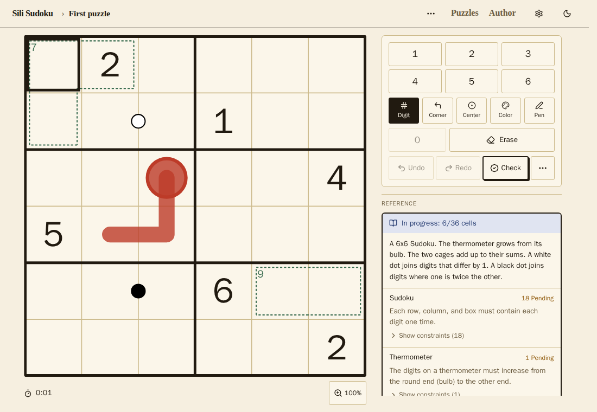

# Sili Sudoku

Play variant Sudoku in your browser, or make your own puzzles. No account, no install, and it works offline.
The source is available under the [Business Source License](#licence), at
[github.com/Sili-Sudoku/dashboard](https://github.com/Sili-Sudoku/dashboard).



**Status: alpha.** It works and is tested, but only a few puzzles are bundled and the app has had little testing
outside Chromium. See [Known limitations](#known-limitations).

## What you can do

- **Solve.** Digits, corner and centre notes, colours, undo and redo, a timer, and a check against the solution.
- **Make puzzles.** Use the visual editor or write the JSON directly. The solver tells you whether the puzzle has one
  solution, several, or none.
- **Share.** A puzzle link contains the whole puzzle, so it needs no server.
- **Bring puzzles over.** Import from f-puzzles and SudokuMaker, export to SudokuPad. What cannot carry over is
  reported, not dropped silently. See [`docs/IMPORT_FIDELITY.md`](docs/IMPORT_FIDELITY.md).

### Supported variants

Classic Sudoku, killer cages, thermometers, arrows, kropki dots, XV, whisper lines, between lines, palindromes,
sandwich sums, quadruples, parity, min/max, anti-king, anti-knight, non-consecutive, disjoint groups, clones and
negative constraints. Grids can be any size, including Samurai, and there is a fog mode.

## Running it

You need Node.js 24 or newer.

```bash
npm install
npm run dev        # http://localhost:5173
npm test
npm run build
```

Open the **"Four Systems, One Grid"** puzzle for a first look. It has a classic Sudoku, a killer cage, a
thermometer, and an arrow on one board.

## Contributing

See [`CONTRIBUTING.md`](CONTRIBUTING.md). For the checks to run before a change, see
[`docs/CONVENTIONS.md`](docs/CONVENTIONS.md).

## Privacy

Today the app has no server, no accounts, no cookies, and no analytics. Your settings, saved progress, and solve times
are stored in your browser (localStorage) and stay on your device. The Content Security Policy only allows requests to
the site itself, and a test checks that the app works with the network blocked. A puzzle link contains the whole puzzle
in the URL, so anyone you send it to can read it. A source link on a puzzle opens another website only after you
confirm.

## Known limitations

- Everything is stored in your browser (localStorage). There are no accounts, no sync between devices, and no puzzle
  sharing beyond links that contain the whole puzzle.
- Only a few puzzles are bundled.
- Only Chromium has been tested. Firefox, Safari, iOS, and real touch devices are not checked yet.
- Imports from other tools cover the common rules, not all of them. Anything skipped gets a warning. See
  [`docs/IMPORT_FIDELITY.md`](docs/IMPORT_FIDELITY.md). Penpa+ is not supported.
- The solver can be slow on very hard or very large puzzles.

## How it works

No variant is built into the engine. It knows only generic primitives: cells, regions, values, sums, ordering,
counting, logic, and adjacency. A thermometer is a five-line definition that compiles to
`["strictIncreasing", ["cells", [...]]]` plus a few visual objects. Delete `src/definitions/` and the runtime still
works, and puzzles written with primitive constraints still load, evaluate, render, and play.

```
PuzzleDefinition (JSON artifact: metadata, geometry, domain, givens,
        │                        regions, objects, constraints, solution)
        │   parsePuzzle → compilePuzzle(def, definitionRegistry)
        ▼
CompiledPuzzle  { geometry, domain, givens, regions, objects,
        │          constraints: primitive Expr[] }
        │
   ┌────┴───────────────┬────────────────────┐
   ▼                    ▼                    ▼
PuzzleSession       evaluate()           buildScene() → <Board/>
selection, entry,   Kleene 3-valued:     generic SVG shapes
notes, undo/redo    satisfied /          (polyline, circle, cage,
                    violated /           arrowhead, text …)
                    incomplete
```

- `src/runtime/` is the engine. It is pure TypeScript and has no React import.
  Most tests are here.
- `src/definitions/` holds the variant packages (`sudoku`, `thermometer`,
  `killer`, `arrow`). Each one is a pure function `(params, ctx) => { constraints, objects }`.
  The caller passes the registry **into** `compilePuzzle`. The runtime never imports it.
- `src/renderer/` has `scene.ts` (pure function: geometry to drawable shapes) and `Board.tsx`.
- `src/player/` is the React layer: `usePuzzleSession`, the number pad, the
  controls, and the constraint panel.
- `src/puzzles/` is the dev registry. `mini_sudoku.ts` uses only primitives. It
  shows that the runtime does not depend on definitions.
- `src/authoring/` has `PuzzleBuilder`. A hosted editor can use this fluent API.

## Docs

The [docs index](docs/README.md) says which one to read first.

- [`docs/PUZZLE_FORMAT.md`](docs/PUZZLE_FORMAT.md): the artifact JSON and the
  constraint language reference.
- [`docs/ARCHITECTURE.md`](docs/ARCHITECTURE.md): decisions and trade-offs.
- [`docs/DESIGN.md`](docs/DESIGN.md): the visual identity. It lists which
  parts use the warm "ink & paper" look, which parts keep the original theme,
  and why.
- [`docs/CONVENTIONS.md`](docs/CONVENTIONS.md): the rules for commits and comments, and the checks to run.
- [`docs/UI_PLACEMENT.md`](docs/UI_PLACEMENT.md): where a new control goes.
- [`docs/IMPORT_FIDELITY.md`](docs/IMPORT_FIDELITY.md): which rules survive an import or export.

## URL sharing

`/p/<id>` looks up a puzzle in the dev registry. `/p/<blob>` decodes a full
artifact from the URL (`<codec><base64url(JSON)>`). It needs no server and no
account. The codec byte lets a compressed encoding be added later without a
breaking change.

## Puzzle ownership

Last updated 5 November 2026.

**You own your puzzles.** Everything you make is yours, wherever it came from: made here, imported from another tool, or shared by a link. You keep all rights to it and can do what you like with it.

**What the site may do.** When you publish a puzzle, you let the site show it and pass it on to other people on the site. That is all. The permission is not exclusive, and it ends when you delete the puzzle.

**What the site will not do.** Use your puzzles for anything else. I will not sell them, license them to anyone, or use them to train AI.

**Taking a puzzle down.** You can remove your puzzle at any time. I only remove one myself for safety reasons, or because it breaks the rule below.

**Publish only your own.** Publish only puzzles you made, or have the maker's permission for. Passing off someone else's puzzle as yours is a violation. I will remove it and may stop you from publishing again. The owner keeps all their rights and can act on them directly.

## AI disclaimer

Neither this project nor I am against AI development or AI tooling. What matters at the end of the day is the quality
of the work, and transparency about it.

AI helped write the code. I'm a professional developer and did not need AI to build this site, but it saved a
significant amount of time. The architecture and the design decisions are mine. Puzzles are made by people, not by AI.
This project will never generate puzzles or art.

I expect everything here to be human-designed. Tools that help a person get their own idea into the format are fine.
For example, an AI can turn a rule you thought of into the JSON config. Passing off AI-generated work as your own is
not welcome.

## Licence

[Business Source License 1.1](LICENSE). Each version converts to Apache-2.0 four years after its first public release.

### Why this licence

Open source is very important to me, and in normal circumstances this project would use an open source licence. But AI
has made it very cheap to rebuild what is here, so for now I have chosen a source-available licence instead.

The source is open to read, run, change, and use in production, for free. The one limit is that you may not offer it,
or a derivative, as a hosted puzzle service that competes with my own offerings. After four years, each version
becomes Apache-2.0, a fully permissive open source licence.

If you have something interesting you would like to build with this, even if it competes, email me at
`contact@silical.dev` or open an issue. I will most likely grant permission.

Not affiliated with SudokuPad, SudokuMaker, f-puzzles, or Penpa+. See
[`NOTICE`](NOTICE) for the third-party names and logos used.
